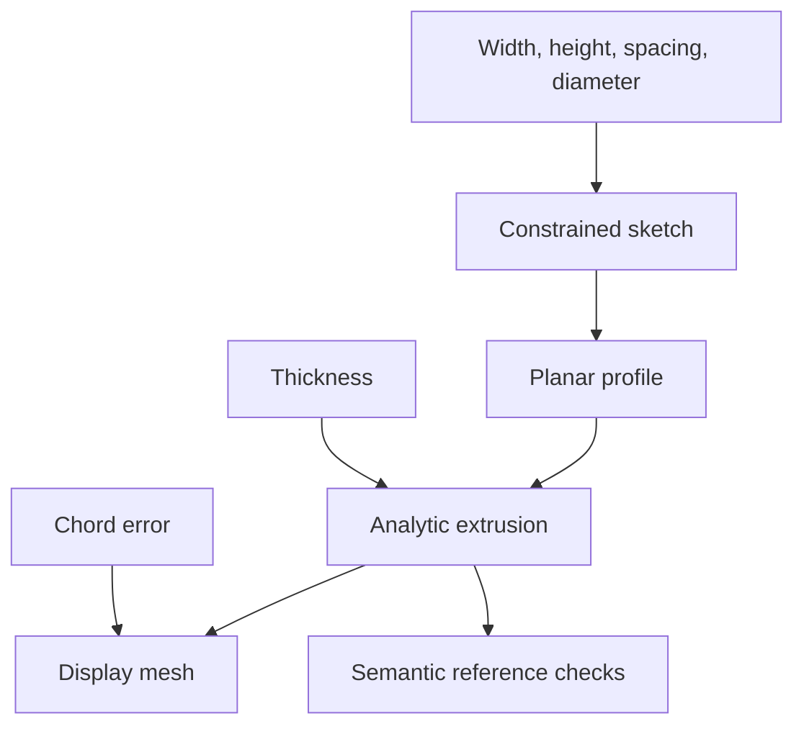

# Parametric CAD and transactional feature regeneration

Import `package:dart_csp/cad.dart` (also exported by `dart_csp.dart`). This
experimental layer connects constrained geometric sketches to parameter-driven
solid features, analytic topology, semantic references and display meshes.

The executable reference model is a **two-hole mounting plate**, a planar
mounting-bracket variant. Run:

```sh
dart run example/parametric_bracket.dart
dart run benchmark/cad.dart
dart test test/cad_features_test.dart test/parametric_cad_test.dart
```

The example solves a centered rectangular sketch and symmetric hole locations,
extrudes the profile, tessellates the solid, and validates downstream face
references. Width, height, thickness, hole spacing, hole diameter and display
chord error are editable. An invalid diameter keeps the previous parameters,
sketch, body, mesh and references. This fixture does not include a bend or fillet.

## Parameter edits and dependencies

`CadParameters` is an immutable snapshot with document and per-parameter
revisions. `CadExpression.parameter('thickness')` builds dependency-aware
arithmetic using `+`, `-`, `*` and `/`. A feature declares the parameters and
other features it reads. Evaluators see only declared inputs, so an undeclared
read fails instead of silently bypassing invalidation.



`document.regenerate(changes: {'thickness': 8})` rebuilds only the extrusion
and its mesh. A spacing edit also rebuilds the sketch and profile. An identical
edit returns `CadRegenerationStatus.unchanged` with no rebuilt features. The
returned `rebuiltFeatures` and `state.featureRevisions` expose actual work.

The document evaluates into candidate output maps. It commits once every dirty
feature, body/mesh validation and required topology reference has succeeded.
`CadRegenerationStatus.rejected` returns the exact previous `state`, plus issues
and the failed feature ID. A failed candidate never becomes a subsequent warm
start. Custom evaluators and custom outputs must be immutable/pure; the document
cannot undo arbitrary side effects inside application callbacks.

The graph is immutable after construction. Structural feature additions/removals
require building a new document. Parameter edits reuse its dependency order.

## Connecting a geometric sketch

`constrainedSketchFeature` accepts a `CompiledGeometryModel`, fixed scalar
dimension bindings expressed with `CadExpression`, and a profile-building
callback. It returns a feature whose output is `CadSolvedSketch`. The output
contains the successful `GeometrySolveResult`, a `CadPlanarProfile` and whether
the last committed coordinates seeded the solve. Failed/limited numerical
results reject the feature; they are never turned into a solid profile.

```dart
final sketchFeature = constrainedSketchFeature(
  id: 'sketch',
  model: compiledSketch,
  dimensionBindings: {
    'width': CadExpression.parameter('width'),
    'radius': CadExpression.parameter('holeDiameter') / 2,
  },
  buildProfile: (geometry, parameters) {
    // Convert geometry.values into the backend's supported planar profile.
    // Check orientation/branch assumptions at this boundary as appropriate.
    return profileFromSolvedCoordinates(geometry.values);
  },
);
final profileFeature = sketchProfileFeature(id: 'profile', sketch: 'sketch');
final extrusionFeature = CadFeatureNode.extrude(
  id: 'plate',
  profile: 'profile',
  depth: CadExpression.parameter('thickness'),
);
```

Bindings must reference existing fixed scalar blocks. The compiled structure
and previous coordinates are reused. This transactional adapter intentionally
uses a fresh numerical workspace per candidate so a downstream solid failure
cannot mutate the committed sketch state. Direct `GeometrySolveSession` edits
retain workspaces as well. CAD regeneration therefore does not inherit every
speedup of an already-live interactive geometry session.

`CadFeatureContext.previousOutput<T>()` exposes only the same feature's last
committed output. This supports deterministic warm starts without exposing
undeclared dependencies or rejected candidates.

## Analytic body, topology and mesh

`CadBody` contains analytic surfaces and curves, vertices, shared edges,
oriented boundary loops, semantic identities, finite bounds and analytic
volume. `CadMesh` is a separate display/export approximation with triangle
face IDs and a requested chord error. Changing display resolution does not
change the analytic solid.

Reference-kernel validation checks its supported construction, dimensions,
metrics, finite geometry, edge incidence and closed boundary loops. Mesh
validation checks indices, finite vertices, nondegenerate triangles, opposite
edge use and positive oriented volume. These are checks for the implemented
subset; they do not certify arbitrary third-party surfaces or triangle
self-intersections.

Use a semantic reference such as:

```dart
const TopologyRef(
  featureId: 'plate',
  semanticId: 'hole.left.wall',
  kind: CadTopologyKind.face,
);
```

`state.resolve(reference)` returns `found`, `missing` or `ambiguous`. A stable
semantic ID expresses design intent and is independent of face-list order.
Required references reject a transaction if missing or ambiguous. A backend
must propagate actual operation provenance: assigning the same name to several
split faces reports ambiguity, and the document does not guess a replacement.

## Kernel capabilities and current scope

`CadKernel` defines extrusion, revolution, union/difference/intersection,
filleting, shelling, validation and tessellation. Every operation returns
`CadKernelResult<T>` with an explicit status and issues. Capability flags describe
which operation families a backend implements; each operation still validates
its accepted geometry subset.

| Operation | Pure-Dart reference backend |
|---|---|
| Extrusion | Centered XY rectangle with identified, nonintersecting circular through-holes; positive depth |
| Analytic surfaces | Planes and cylinders; line and circular edges |
| Tessellation | Same extrusion; holes must have disjoint X projections; at most 4,096 segments per hole |
| Semantic references | Stable named sides, top/bottom, corners and identified hole walls/rims |
| Revolution | Explicit `unsupported` |
| General booleans | Explicit `unsupported` |
| Fillets and shells | Explicit `unsupported` |

A production solid kernel adapter is still needed for those general operations,
arbitrary sketch contours and mature topology repair. The pure-Dart constraint
and feature layers do not depend on an FFI or browser backend. Such adapters
belong behind `CadKernel`, with their own capability/tolerance/provenance tests.
No external kernel or licensing dependency has been added by this work.

## Measured work and limits

One Dart 3.14.0 native JIT Linux x64 container run used three warmup groups and
25 measured groups, alternating the order of paths. Hardware was not pinned.
Analytic volume and closed mesh checks ran outside the timed sections.

| Current implementation path | Median | p95 | Rebuilt features |
|---|---:|---:|---|
| Build, compile and initially regenerate | 3.300 ms | 9.736 ms | All |
| Edit width/spacing and regenerate | 3.401 ms | 14.930 ms | Sketch, profile, extrusion, mesh |
| Edit thickness and regenerate | 2.382 ms | 5.383 ms | Extrusion, mesh |

The profile-edit path is not faster in this fixture. The initial sketch starts
at its exact dimensions; the edit path must solve changed dimensions. This
benchmark establishes correctness and selective rebuilds, not a general speed
multiplier or a production interaction guarantee. Timings are reproducible with
`benchmark/cad.dart`; the recorded sample is in
`benchmark/results/2026-11-13-cad.json`.

Eighteen focused tests cover kernel geometry, independent mesh incidence and
winding, constrained sketch integration, dimension changes, immutable snapshots,
selective regeneration and numerical/solid/topology rollback. Platform checks
and larger CAD corpora are separate validation gates.
