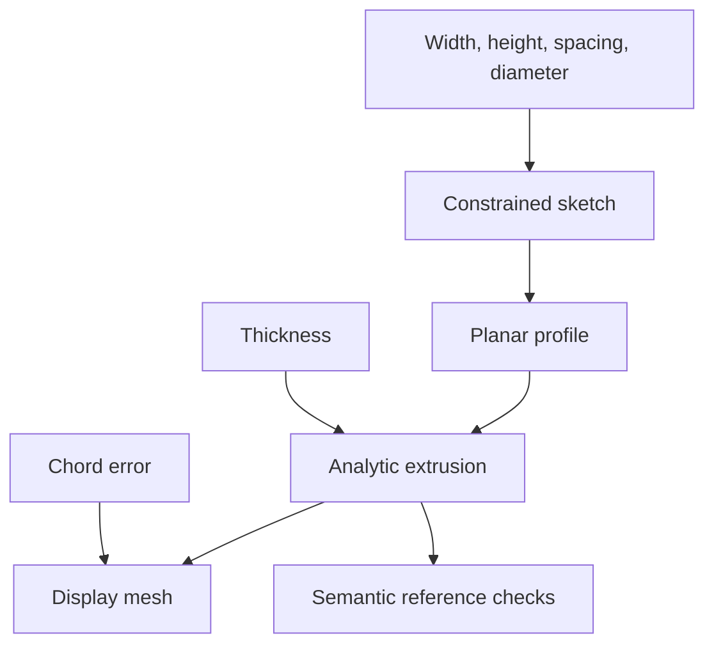

# Parametric CAD and transactional feature regeneration

Import `package:dart_csp/cad.dart` (also exported by `dart_csp.dart`). This
experimental layer connects constrained geometric sketches to parameter-driven
solid features, analytic topology, semantic references and display meshes.

The executable reference model is a **two-hole mounting plate**, a planar
mounting-bracket variant. Run:

```sh
dart run example/parametric_bracket.dart
dart run example/parametric_assembly.dart
dart run benchmark/cad.dart
dart run benchmark/cad_instances.dart
dart test test/cad_features_test.dart test/parametric_cad_test.dart
```

The example solves a centered rectangular sketch and symmetric hole locations,
extrudes the profile, tessellates the solid, and validates downstream face
references. Width, height, thickness, hole spacing, hole diameter and display
chord error are editable. An invalid diameter keeps the previous parameters,
sketch, body, mesh and references. This fixture does not include a bend or fillet.

## Parameter edits and dependencies

`CadParameters` is an immutable snapshot with document and per-parameter
revisions. `CadExpression.parameter('thickness')` builds dependency-aware
arithmetic using `+`, `-`, `*` and `/`. A feature declares the parameters and
other features it reads. Evaluators see only declared inputs, so an undeclared
read fails instead of silently bypassing invalidation.



`document.regenerate(changes: {'thickness': 8})` rebuilds only the extrusion
and its mesh. A spacing edit also rebuilds the sketch and profile. An identical
edit returns `CadRegenerationStatus.unchanged` with no rebuilt features. The
returned `rebuiltFeatures` and `state.featureRevisions` expose actual work.

The document evaluates into candidate output maps. It commits once every dirty
feature, body/mesh validation and required topology reference has succeeded.
`CadRegenerationStatus.rejected` returns the exact previous `state`, plus issues
and the failed feature ID. A failed candidate never becomes a subsequent warm
start. Custom evaluators and custom outputs must be immutable/pure; the document
cannot undo arbitrary side effects inside application callbacks.

The graph is immutable after construction. Structural feature additions/removals
require building a new document. Parameter edits reuse its dependency order.

## Connecting a geometric sketch

`constrainedSketchFeature` accepts a `CompiledGeometryModel`, fixed scalar
dimension bindings expressed with `CadExpression`, and a profile-building
callback. It returns a feature whose output is `CadSolvedSketch`. The output
contains the successful `GeometrySolveResult`, a `CadPlanarProfile` and whether
the last committed coordinates seeded the solve. Failed/limited numerical
results reject the feature; they are never turned into a solid profile.

```dart
final sketchFeature = constrainedSketchFeature(
  id: 'sketch',
  model: compiledSketch,
  dimensionBindings: {
    'width': CadExpression.parameter('width'),
    'radius': CadExpression.parameter('holeDiameter') / 2,
  },
  buildProfile: (geometry, parameters) {
    // Convert geometry.values into the backend's supported planar profile.
    // Check orientation/branch assumptions at this boundary as appropriate.
    return profileFromSolvedCoordinates(geometry.values);
  },
);
final profileFeature = sketchProfileFeature(id: 'profile', sketch: 'sketch');
final extrusionFeature = CadFeatureNode.extrude(
  id: 'plate',
  profile: 'profile',
  depth: CadExpression.parameter('thickness'),
);
```

Bindings must reference existing fixed scalar blocks. The compiled structure
and previous coordinates are reused. This transactional adapter intentionally
uses a fresh numerical workspace per candidate so a downstream solid failure
cannot mutate the committed sketch state. Direct `GeometrySolveSession` edits
retain workspaces as well. CAD regeneration therefore does not inherit every
speedup of an already-live interactive geometry session.

`CadFeatureContext.previousOutput<T>()` exposes only the same feature's last
committed output. This supports deterministic warm starts without exposing
undeclared dependencies or rejected candidates.

## Rigid 3D instances and constrained assemblies

`CadBodyInstance` places an analytic prototype in three dimensions using an
immutable `CadRigidTransform`. Translation and quaternion rotation preserve
radius, oriented volume and boundary winding; scaling and reflection are not
supported. Quaternions use scalar-first `[w, x, y, z]` order and finite nonzero
quaternions are normalized safely even at very large or small scales. Axis-angle
construction uses radians. `compose(local)` applies the local transform first;
`inverse()` reverses a placement.

A placement feature declares its parameter dependencies just like a solid:

```dart
CadFeatureNode.instance(
  id: 'upright',
  body: 'plate',
  placement: CadPlacementExpression(
    x: CadExpression.parameter('offset'),
    angle: CadExpression.parameter('tilt'),
    axis: const CadPoint3(1, 0, 0),
  ),
);
```

An offset or tilt edit rebuilds only the instance. The local `CadBody` and its
separately held `CadMesh` keep their identities. Multiple instances can share one
prototype and one tessellation. Render the local mesh with
`instance.placement.toColumnMajorMatrix4()`; ordinary dragging does not allocate
world-space vertices or retessellate the part. When explicit export coordinates
are needed, `instance.placement.transformMesh(localMesh)` materializes and
validates them. It rejects coordinate overflow and meshes collapsed by rounding
at extreme translations. The caller supplies the local mesh corresponding to
the prototype; this method transforms and validates that mesh, without certifying
its correspondence to arbitrary analytic surfaces.

`state.resolve(TopologyRef(featureId: 'upright', ...))` resolves world-space
vertices, line/circle edges and plane/cylinder faces. Circle radii and cylinder
inward orientation remain unchanged; normals and axes rotate. Semantic meanings
remain local to each instance feature, so two occurrences of the same part can
both have a `top` face without ambiguity. Multiple matching meanings within one
prototype still report `ambiguous`. World bounds are conservative AABBs computed
with outward-rounded arithmetic. Local topology and the kernel construction
record remain attached to the prototype; a placed occurrence is not a new kernel
solid or an input to a general solid boolean.

For solver-driven placement, `constrainedGeometryFeature` binds fixed scalar
parameters to an arbitrary compiled 3D geometric model and returns only a
successful `GeometrySolveResult`. Connect its `GeometryPose` to a part using:

```dart
CadFeatureNode.instanceFromPose(
  id: 'upright',
  body: 'plate',
  geometry: 'assembly',
  pose: uprightPose,
);
```

The executable `example/parametric_assembly.dart` contains two perpendicular
instances of one plate. Geometric axis mates constrain their orientation, while
height and clearance dimensions set the upright translation. A clearance edit
rebuilds only the assembly solve and upright instance. A shape edit rebuilds the
prototype, its mesh and dependent occurrences. Invalid dimension/quaternion,
failed numerical solve, backend validation or required semantic reference rejects
the whole transaction. Downstream failure cannot seed the next solve with
uncommitted coordinates. As with the sketch adapter, candidate numerical
workspaces are isolated; only compiled structure and committed coordinates are
retained between these feature transactions.

Instances give the feature system an executable multi-solid 3D assembly path.
They do not fuse plates, resolve collisions or add unsupported boolean, fillet,
shell or arbitrary-contour operations to the reference kernel. The generic
instance topology adapter currently understands only its line/circle and
plane/cylinder types; other surface families need a backend-specific adapter.

## Analytic body, topology and mesh

Reference-owned bodies and meshes retain the results of their complete
validation because their concrete geometry and topology are deeply immutable.
Reference meshes also retain signed volume. Normal extrusion regeneration now
performs one full body traversal and one full mesh traversal, while retaining
the validation calls at each boundary. Public objects, copies and custom value
subclasses are checked on every call; a custom kernel's validator override still
runs even when its base geometry check reuses a result. Numeric coordinate keys
also avoid formatting strings for each tessellated triangle corner.

`CadBody` contains analytic surfaces and curves, vertices, shared edges,
oriented boundary loops, semantic identities, finite bounds and analytic
volume. `CadMesh` is a separate display/export approximation with triangle
face IDs and a requested chord error. Changing display resolution does not
change the analytic solid.

Reference-kernel validation compares the solid's actual vertices, curves,
surfaces and boundary cycles with an immutable record of its supported
construction. Missing topology, moved geometry and a construction record
borrowed from another body are rejected. Equivalent geometric representations,
entity ordering and semantic-ID remaps remain independent of solid validity.

Mesh validation checks indices, finite vertices, scaled triangle areas, opposite
edge use and positive oriented volume. Volume uses a local reference vertex and
compensated accumulation, avoiding the catastrophic cancellation of absolute-
origin tetrahedra after a large rigid translation. It cannot recover coordinates
that were already rounded away. It rejects duplicate triangles, isolated
vertices and pinched vertices whose incident triangles do not form one connected
cycle. Unresolved floating-point area/volume and invalid chord errors are
reported explicitly. These numerical and combinatorial checks cover the
implemented subset; they do not provide exact predicates or certify arbitrary
third-party surfaces or triangle self-intersections. Invalid bodies and meshes
are rejected before a feature transaction commits.

Use a semantic reference such as:

```dart
const TopologyRef(
  featureId: 'plate',
  semanticId: 'hole.left.wall',
  kind: CadTopologyKind.face,
);
```

`state.resolve(reference)` returns `found`, `missing` or `ambiguous`. A stable
semantic ID expresses design intent and is independent of face-list order.
Required references reject a transaction if missing or ambiguous. A backend
must propagate actual operation provenance: assigning the same name to several
split faces reports ambiguity, and the document does not guess a replacement.

## Kernel capabilities and current scope

`CadKernel` defines extrusion, revolution, union/difference/intersection,
filleting, shelling, validation and tessellation. Every operation returns
`CadKernelResult<T>` with an explicit status and issues. Capability flags describe
which operation families a backend implements; each operation still validates
its accepted geometry subset.

| Operation | Pure-Dart reference backend |
|---|---|
| Extrusion | Centered XY rectangle with identified, nonintersecting circular through-holes; positive depth |
| Analytic surfaces | Planes and cylinders; line and circular edges |
| Tessellation | Same extrusion; holes must have disjoint X projections; at most 4,096 segments per hole |
| Semantic references | Stable named sides, top/bottom, corners and identified hole walls/rims |
| Rigid instances (feature layer) | Arbitrary finite 3D placement of shared prototypes; world-space topology, shared renderer mesh and optional mesh materialization |
| Constrained assembly (feature layer) | Successful geometric poses drive placed occurrences transactionally; no solid union or collision certificate |
| Revolution | Explicit `unsupported` |
| General booleans | Explicit `unsupported` |
| Fillets and shells | Explicit `unsupported` |

A production solid kernel adapter is still needed for those general operations,
arbitrary sketch contours and mature topology repair. The pure-Dart constraint
and feature layers do not depend on an FFI or browser backend. Such adapters
belong behind `CadKernel`, with their own capability/tolerance/provenance tests.
No external kernel or licensing dependency has been added by this work.

## Measured work and limits

The final Dart 3.14.0 native JIT sample at `689c38b` used three warmup groups and
25 measured groups, alternating the order of paths. Hardware was not pinned.
Analytic volume and closed mesh checks ran outside the timed sections.

| Current implementation path | Median | p95 | Rebuilt features |
|---|---:|---:|---|
| Build, compile and initially regenerate | 3.850 ms | 5.109 ms | All |
| Edit width/spacing and regenerate | 4.026 ms | 7.513 ms | Sketch, profile, extrusion, mesh |
| Edit thickness and regenerate | 3.250 ms | 4.280 ms | Extrusion, mesh |

The profile-edit path is not faster in this fixture. The initial sketch starts
at its exact dimensions; the edit path must solve changed dimensions. This
benchmark establishes correctness and selective rebuilds, not a general speed
multiplier or a production interaction guarantee. Timings are reproducible with
`benchmark/cad.dart`; the recorded sample is in
`benchmark/results/2026-11-13-final.json`. Earlier checkpoint samples are retained
separately.

The current focused CAD suite contains 58 tests covering kernel geometry,
independent mesh incidence and winding, constrained sketch integration,
translation-stable volume, rigid-transform algebra, conservative bounds, shared
prototype/mesh reuse, solved assembly placement, malformed boundaries,
disconnected vertex links and numerical/solid/topology rollback. Platform checks
and larger CAD corpora are separate validation gates.

`benchmark/cad_instances.dart` compares the current cold assembly build with
repeated solved clearance edits using the same independent coordinate, normal
and analytic-volume checks. Its counters require exactly one extrusion and one
tessellation over the retained document's entire run; pose edits rebuild only
`assembly` and `upright`. This is a current cold/reuse comparison, not a measured
speedup over an old release, and does not establish a universal interaction
latency. Timing processes should run sequentially on a named platform.
